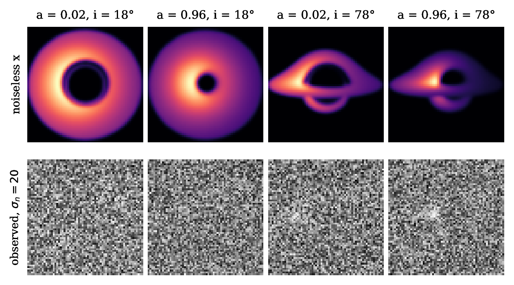
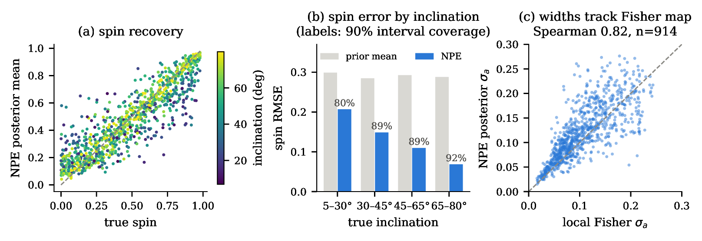
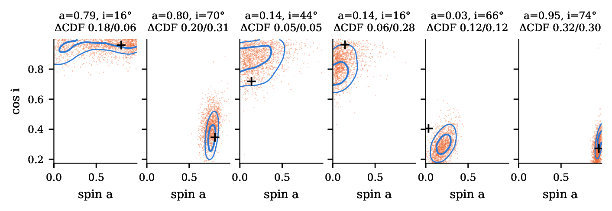

# kerr-sbi

This project trains a neural network to infer the spin *a* and viewing inclination *i*
of a Kerr black hole from a small, noisy image of its accretion disk. Alongside the
inference itself, we examine which features of the image carry the spin information. In
this model it is mostly the position of the disk's inner edge, which is assumed to lie at
the ISCO.



*Simulated 64 × 64 images (top) and the noisy versions the network actually sees (bottom).
Higher spin pulls the disk's inner edge closer to the hole. Higher inclination brings out
Doppler beaming and the lensed image of the far side of the disk.*

## Method

Training images are rendered with the general-relativistic ray tracer
[nullgeo](https://github.com/James-Wirth/nullgeo). The disk is geometrically thin, extends
from the ISCO to 15 *M*, and has emissivity ∝ *g*³ *r*⁻², where *g* is the redshift factor.
Parameters are drawn uniformly in *a* ∈ [0, 0.98] and cos *i* for *i* ∈ [5°, 80°]. Each
image is convolved with a Gaussian PSF, normalised to unit mean flux and given white
Gaussian noise with σₙ = 20 per pixel.

A CNN compresses each image to a 64-dimensional summary that conditions a rational-quadratic
spline flow over (*a*, cos *i*). The estimator is implemented in JAX (Equinox, Optax, FlowJAX)
and trains in minutes on a laptop CPU.

## Results

**Parameter recovery.** On 1,000 held-out observations, a pilot model trained on 1,800
images gives posterior-mean RMSEs of 0.13 in *a* and 7.4° in *i* (prior: 0.28 and 17°).
Spin is far better constrained at high inclination (RMSE 0.07 at 65–80°, 0.21 at 5–30°),
and posterior widths correlate with local Fisher-information bounds (Spearman ρ = 0.82).



**Spin information resides in the ISCO.** The noise-scaled separation between images at
*a* = 0 and *a* = 0.98 falls by an order of magnitude when the inner edge is fixed at 8 *M*
rather than at the ISCO:

| Inner edge | 18° | 45° | 68° | 78° |
| ---------- | --: | --: | --: | --: |
| ISCO       | 3.2 | 5.7 | 11.0 | 14.6 |
| 8 *M*      | 0.14 | 0.41 | 1.1 | 2.2 |

The spin constraint is therefore largely a measurement of the disk's inner edge. For a
disk truncated at 8 *M* (*a* = 0.15, *i* = 78°), a model assuming the ISCO returns a 90%
interval of [0.001, 0.097] that excludes the truth; marginalising over the inner radius
broadens the posterior from σ = 0.035 to ≈ 0.22 (provisional).

**Comparison with exact posteriors.** The renderer is deterministic and the noise Gaussian,
so the likelihood is explicit. Numerical reference posteriors for 18 observations show
that the network recovers the posterior geometry, including prior truncation at low
inclination, but its spin widths are typically 16% too large and vary between training
seeds.



*Blue: 50% and 90% reference contours. Orange: neural posterior samples. Crosses: truth.*

**Ongoing.** Simulation-based calibration on the reserved test set; forecasts with 2017
EHT M87 baseline coverage, in which fitted source size, orientation and flux absorb much
of the spin signal (provisional); and validation of nullgeo against Luminet (1979).
See also the [status report](assets/research/status-report-2026-09-26.pdf) (26 Sep 2026).

## Usage

Requires Python 3.13, [uv](https://docs.astral.sh/uv/) and Cargo.

```sh
uv sync --locked
cargo install nullgeo-cli --version 0.2.0 --locked --root .tools/nullgeo
export NULLGEO_BIN="$PWD/.tools/nullgeo/bin/nullgeo"
uv run python scripts/run_pilot.py --dataset pilot_v1 --run pilot_01
uv run pytest -m 'not slow'
```

The pilot renders 2,000 training and 200 development images (a few hours), then trains
and evaluates the estimator (minutes). Other stages are in `scripts/` (see `--help`);
settings are in `configs/default.toml`.
